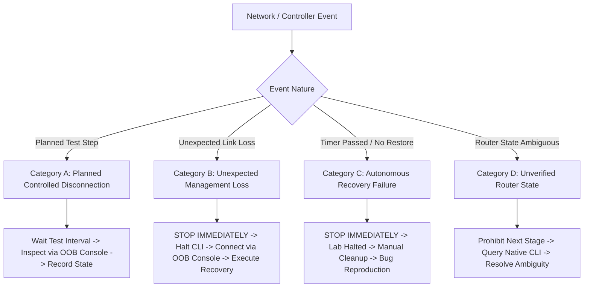
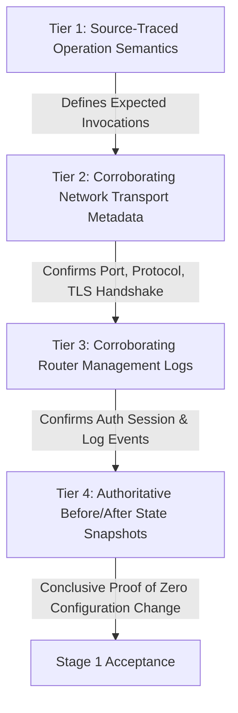

# Rustrict — Laboratory Safety Protocol & Staged Execution Plan (Stage 1 Evidence Criteria Hardened)

**Audit & Safety Gate Cycle:** Pre-Lab Safety Gate Review  
**Date:** 2026-10-26  
**Status:** Bounded Protocol — Mandatory Gate Controls for Isolated Hardware Testing  
**Target Hardware:** Dedicated / Isolated Physical Appliances (OpenWrt, MikroTik, UniFi, FRITZ!Box)  

> [!CAUTION]
> **STRICT SAFETY CONSTRAINT:** This protocol is strictly authorized for an **isolated, dedicated hardware testbed or air-gapped laboratory environment**. It must **NEVER** be executed against production, enterprise, home, or everyday routers. Testing must proceed sequentially from Stage 1 through Stage 6; no mutating stage may be initiated before Stage 1 read-only diagnostics and out-of-band recovery are verified.

---

## 1. Disconnection & Loss-of-Access Taxonomy

The laboratory safety protocol recognizes four distinct failure and disconnection states. Each state imposes specific operator obligations, stop conditions, and recovery procedures:



### Category A: Planned, Explicitly Authorized Disconnection
- **Definition:** The operator intentionally stops the Rustrict controller process (`Stop-Process -Name rustrict -Force`) or disconnects the controller's Ethernet link to test autonomous router-side expiry or crash recovery.
- **Preconditions:** The test must be an explicitly documented step in Stage 3 or Stage 5; out-of-band console access must be verified immediately prior to link disconnection.
- **Required Operator Action:**
  1. Record the exact disconnect timestamp.
  2. Maintain out-of-band observation (serial or secondary monitor) without issuing new mutations.
  3. Wait for the predetermined expiry duration plus a 60-second observation buffer.
  4. Inspect router state independently via out-of-band CLI.
- **Permitted Next Step:** Reconnecting controller PC **only after** router state has been verified via out-of-band console. **No additional mutations may be attempted while the router's recovery state remains unverified.**
- **Stop Condition:** If out-of-band observation reveals router instability or hanging schedules, abort immediately.

### Category B: Unexpected Disconnection or Loss of Management Access
- **Definition:** Loss of ping, SSH, REST, or web management to the router occurring outside of an authorized Stage 3/5 test step (e.g. controller interface lockout, router firewall daemon panic, or gateway unreachable).
- **Mandatory Rule:** **An unexpected loss of management access must NEVER be classified as a successful test.**
- **Required Operator Action:**
  1. **HALT TESTING IMMEDIATELY.** Do not press keys or issue further commands in Rustrict CLI.
  2. Terminate the Rustrict process to eliminate background retries or transport loops.
  3. Connect immediately via the dedicated out-of-band console (serial terminal or secondary management NIC).
  4. Inspect router firewall state and kernel logs (`logread`, `/log print`, `dmesg`).
- **Recovery Method:** Execute Section 6 Emergency Manual Recovery.
- **Permitted Next Step:** Complete diagnostic autopsy; no further testing until root cause is identified and remediated in code.

### Category C: Failure of Router-Side Recovery Mechanism
- **Definition:** A temporary policy was applied (e.g. 2-minute duration), but upon timer expiration, the router firewall rule remains active or client traffic remains blocked.
- **Required Operator Action:**
  1. Mark test stage as **FAILED**.
  2. Access router via out-of-band console and inspect scheduler/crontab queues (`crontab -l`, `/system scheduler print`).
  3. Execute manual rule removal via native commands.
- **Stop Condition:** Immediate full lab stop. Under no circumstances may multi-target or persistence tests proceed if autonomous single-target recovery fails.

### Category D: Failure to Independently Verify Resulting Router State
- **Definition:** The Rustrict CLI reports `Successfully resumed` or `Policy revoked`, but router-native configuration tools (`uci`, WebFig, UniFi Controller) cannot confirm whether the rule was removed from hardware forwarding tables.
- **Mandatory Rule:** **Router-side state is authoritative.** Local UI or policy-engine JSON state cannot substitute for physical verification.
- **Required Operator Action:** Prohibit advancement to the next stage until router-native inspection confirms exact table status.

---

## 2. Laboratory Prerequisites & Environmental Controls

Before executing any commands, the operator must verify and check off every prerequisite:

### 2.1. Environmental & Physical Safeguards
- [ ] **Dedicated Isolated Testbed:** Test router is connected to an isolated test switch or air-gapped VLAN. Absolutely zero uplink to production corporate or home networks.
- [ ] **Single Instance Constraint:** Verify via PowerShell that exactly one instance of Rustrict is running:
  ```powershell
  Get-Process rustrict -ErrorAction SilentlyContinue | Measure-Object | Select-Object -ExpandProperty Count
  # Must equal 0 before starting, and 1 after starting.
  ```
- [ ] **Single Provider Constraint:** Exactly one router appliance under test. Multi-provider concurrent testing is strictly prohibited.
- [ ] **Out-of-Band (OOB) Channel Active:** Serial console (e.g. USB-UART at 115200 baud) or secondary LAN port with independent static subnet is connected and verified responsive.
- [ ] **Clean Baseline Backup:** Router configuration backed up to controller PC prior to opening Rustrict:
  - OpenWrt: `uci export > openwrt_baseline.uci`
  - MikroTik: `/export file=mikrotik_baseline`
  - UniFi: Download `.unf` backup from UniFi OS Console.
  - FRITZ!Box: Save configuration export file via web interface.

### 2.2. Controller Host Environment
- [ ] OS: Windows 10/11 Pro (x86_64).
- [ ] Binary: Release build at `D:\Vault\Rustrict\target\release\rustrict.exe`.
- [ ] Network capture: Wireshark running on the controller's active test interface.

---

## 3. Stage 1: Strictly Read-Only Authenticated Diagnostics Runbook

*Objective: Confirm authenticated connection, transport integrity, and identity query without altering router rules or configurations.*

### 3.1. Provider-Specific Operation Allowlist & Semantic Classification

Blanket HTTP-method restrictions (e.g. "forbid all POST requests") are semantically invalid because standard protocols like TR-064 (SOAP over HTTP POST) and UniFi session authentication rely on HTTP POST for read-only actions. 

The Stage 1 operation allowlist is established strictly from source code tracing:

| Provider | Permitted Stage 1 Operation | Underlying Transport & HTTP Method | Production Source Location | Semantic Classification & Verification Evidence |
| :--- | :--- | :--- | :--- | :--- |
| **All** | `router providers` | None (Local in-memory) | `prompt.rs:1089` | Pure in-memory query. Zero network packets. |
| **All** | `router capabilities` | None (Local in-memory) | `prompt.rs:1111` | Pure in-memory query. Zero network packets. |
| **All** | `router inventory` | None (Local in-memory) | `prompt.rs:1085` | Pure in-memory query. Zero network packets. |
| **All** | `router disconnect` | None (Session tear-down) | `prompt.rs:1094` | Clears active Arc handle. Zero network packets. |
| **OpenWrt (SSH)** | `router connect ssh` (Auth) | SSH process execution: `id -u` | `ssh.rs:786` | Verifies root UID 0. Reads user ID; zero filesystem/firewall changes. |
| **OpenWrt (SSH)** | `router status` (Identity) | SSH process: `ubus call system board` | `ssh.rs:888` $\to$ `openwrt.rs:530` | Queries OS distribution and model info. Zero state changes. |
| **OpenWrt (SSH)** | `router diagnostics` | SSH process: `ubus call uci get '{"config":"firewall"}'` | `ssh.rs:888` $\to$ `openwrt.rs:687` | Reads firewall UCI config via ubus. Zero state changes. |
| **MikroTik** | `router connect mikrotik` | HTTPS GET `/rest/system/resource` | `mikrotik.rs:782` | HTTP Basic Auth handshake + OS resource query. Read-only. |
| **MikroTik** | `router status` | HTTPS GET `/rest/system/identity` | `mikrotik.rs:829` | Queries device identity string. Read-only GET. |
| **MikroTik** | `router diagnostics` | HTTPS GET `/rest/ip/firewall/filter` | `mikrotik.rs:945` | Reads existing firewall filter rules. Read-only GET. |
| **AVM FRITZ!Box**| `router connect avm` (Auth) | HTTP POST `/upnp/control/deviceinfo` (SOAP `GetInfo`) | `avm.rs:1095` | TR-064 MD5/Digest Challenge + DeviceInfo query. Read-only SOAP. |
| **AVM FRITZ!Box**| `router status` | HTTP POST `/upnp/control/deviceinfo` (SOAP `GetInfo`) | `avm.rs:1095` | Queries Manufacturer, Model, OS Version. Read-only SOAP. |
| **AVM FRITZ!Box**| `router diagnostics` | HTTP POST (SOAP `GetWANAccessByIP`, `GetHostNumberOfEntries`) | `avm.rs:975, 1013` | Queries host WAN filter status. Read-only SOAP. |
| **UniFi** | `router connect unifi` | HTTPS POST `/api/auth/login` (or `/api/login`) | `unifi.rs:570, 586` | Authenticates and acquires session cookie. Does NOT alter config. |
| **UniFi** | `router status` | HTTPS GET `/proxy/network/api/s/{site}/stat/sysinfo` | `unifi.rs:712` | Queries controller version and gateway MAC. Read-only GET. |
| **UniFi** | `router diagnostics` | HTTPS GET `/proxy/network/v2/api/site/{site}/trafficrules` | `unifi.rs:869` | Queries active traffic rules table. Read-only GET. |
| **UniFi** | `router devices` | HTTPS GET `/proxy/network/api/s/{site}/stat/sta` | `unifi.rs:643` | Queries connected client device list. Read-only GET. |

**Operations Strictly Prohibited in Stage 1:**
- `router pause` / `apply_policy`: Generates firewall rules (`uci add`, REST POST `/rest/ip/firewall/filter`, SOAP `DisallowWANAccessByIP`, UniFi POST trafficrule).
- `router resume`: Deletes firewall rules (REST DELETE, SOAP re-allow, `uci revert`).
- `router adjust`: Mutates durations or scheduler jobs.
- `router refresh` / `router reconcile`: **Prohibited in Stage 1** because `unifi.rs:1125` autonomously calls `DELETE` on expired traffic rules.
- `block` / `free` / `limit`: Triggers local WinDivert / ARP spoofing engine (Strictly prohibited).

---

### 3.2. Evidence Layering: Captures, Logs, and Source Semantics

To prevent over-claiming the scope of any single diagnostic tool, the test protocol establishes four distinct, layered tiers of evidence:



1. **Tier 1 — Source-Traced Operation Semantics:**
   - Defines the exact programmatic behavior and arguments generated by the Rustrict binary.
   - Tracing confirms that Stage 1 commands invoke only read-only getters (`detect_identity`, `query_active_policies`, `inspect_capabilities`).
2. **Tier 2 — Corroborating Network Transport Metadata (Wireshark):**
   - **What Packet Captures Establish:** Destination IP/port, TCP three-way handshake, TLS session establishment, negotiated cipher suites, absence of unencrypted HTTP fallback, absence of ARP poisoning broadcasts, and packet/byte volumes.
   - **What Packet Captures CANNOT Establish:** Under TLS (HTTPS ports 443/8443) and SSH (port 22), payload bytes are strongly encrypted. Wireshark **cannot inspect URL paths, HTTP headers, SOAP actions, JSON bodies, or remote shell command strings**.
   - **Safety Boundary:** **Do NOT disable TLS, downgrade to plaintext HTTP, or install TLS decryption proxies** to inspect payloads. Production cryptographic transport must be preserved.
3. **Tier 3 — Corroborating Router-Side Logging & Process Visibility:**
   - **Logging Limitations:** Router-side logs do NOT log every command or GET query unless specifically configured for debug auditing:
     - **OpenWrt Dropbear:** Default logging captures only session open, authentication success/failure, and session close (`logread -e dropbear`). Individual commands executed via SSH subsystem/exec channels are **not** logged by Dropbear unless external process accounting or auditd is configured.
     - **MikroTik RouterOS:** `/log print where topics~"account"` logs user logins and logouts. REST API URI access is only logged if `/system logging add topics=web` or `topics=rest` is explicitly enabled.
     - **UniFi Network Application:** System logs record administrator logins and configuration changes; routine read-only GET queries are not logged in the administrative event journal.
     - **AVM FRITZ!Box:** System event log records TR-064 administrative logins; routine SOAP query actions are not logged.
   - **Corroborating Value:** Router logs serve to confirm valid authentication, correct origin IP, and absence of administrative error alerts. They corroborate Tier 1 and Tier 2, but do not replace Tier 4.
4. **Tier 4 — Authoritative Before/After State Snapshots:**
   - The primary and conclusive proof that no policy or configuration mutation occurred.
   - Independent out-of-band capture of router configuration and enforcement tables before launching Rustrict and immediately after completing Stage 1.

---

### 3.3. Authoritative Before-and-After Configuration Snapshots

To conclusively prove zero configuration mutation, the operator must execute provider-native snapshot captures before launching Rustrict and immediately after completing Stage 1:

#### 3.3.1. OpenWrt 23.05 Verification Protocol
1. **Pre-Test Snapshot (via OOB Console):**
   ```sh
   # 1. Uncommitted UCI changes (must be completely empty)
   uci changes > /tmp/stage1_pre_changes.txt
   # 2. Complete committed firewall configuration
   uci export firewall > /tmp/stage1_pre_firewall.uci
   # 3. Complete raw nftables ruleset
   nft list ruleset > /tmp/stage1_pre_nft.txt
   # 4. Active crontabs
   crontab -l 2>/dev/null > /tmp/stage1_pre_cron.txt
   ```
2. **Execute Stage 1 Commands in Rustrict CLI.**
3. **Post-Test Snapshot (via OOB Console):**
   ```sh
   uci changes > /tmp/stage1_post_changes.txt
   uci export firewall > /tmp/stage1_post_firewall.uci
   nft list ruleset > /tmp/stage1_post_nft.txt
   crontab -l 2>/dev/null > /tmp/stage1_post_cron.txt
   ```
4. **Independent Diff Evaluation & Separation of Counters:**
   - `diff -u /tmp/stage1_pre_changes.txt /tmp/stage1_post_changes.txt` $\to$ **Must be zero diff (completely empty).**
   - `diff -u /tmp/stage1_pre_firewall.uci /tmp/stage1_post_firewall.uci` $\to$ **Must be zero diff (identical structure).**
   - `diff -u /tmp/stage1_pre_cron.txt /tmp/stage1_post_cron.txt` $\to$ **Must be zero diff.**
   - **NFT Ruleset Evaluation:**
     - To compare stable policy structure separately from dynamic packet counters, strip dynamic counter tokens:
       ```sh
       # Strip dynamic packet/byte counters and handles for structural comparison
       sed -E 's/packets [0-9]+ bytes [0-9]+//g; s/# handle [0-9]+//g' /tmp/stage1_pre_nft.txt > /tmp/stage1_pre_nft_clean.txt
       sed -E 's/packets [0-9]+ bytes [0-9]+//g; s/# handle [0-9]+//g' /tmp/stage1_post_nft.txt > /tmp/stage1_post_nft_clean.txt
       diff -u /tmp/stage1_pre_nft_clean.txt /tmp/stage1_post_nft_clean.txt
       ```
     - **Pass Criteria:** The normalized ruleset diff **must be completely empty**.
     - **Strict Rule:** Raw outputs (`stage1_pre_nft.txt` and `stage1_post_nft.txt`) must be preserved in full for archival review. Dynamic counter increments on pre-existing default rules are acceptable, but **any unexplained structural difference (new table, chain, rule, or set) immediately fails Stage 1**. Differences must not be broadly suppressed.

#### 3.3.2. MikroTik RouterOS v7 Verification Protocol
1. **Pre-Test Snapshot (via WinBox / Serial CLI):**
   ```routeros
   /ip firewall filter export file=stage1_pre_filter
   /ip firewall nat export file=stage1_pre_nat
   /system scheduler export file=stage1_pre_sched
   /system script export file=stage1_pre_script
   ```
2. **Execute Stage 1 Commands in Rustrict CLI.**
3. **Post-Test Snapshot (via WinBox / Serial CLI):**
   ```routeros
   /ip firewall filter export file=stage1_post_filter
   /ip firewall nat export file=stage1_post_nat
   /system scheduler export file=stage1_post_sched
   /system script export file=stage1_post_script
   ```
4. **Independent Diff Evaluation:**
   - Download `.rsc` files to controller PC and execute `diff -u stage1_pre_filter.rsc stage1_post_filter.rsc`.
   - **Pass Criteria:** Diffs must be completely empty. Filter, NAT, scheduler, and script configurations must be 100% identical.

#### 3.3.3. Ubiquiti UniFi Verification Protocol
1. **Pre-Test Snapshot:**
   - Query active Traffic Rules via controller Web UI (Settings $\to$ Security $\to$ Traffic Rules) or API GET `/proxy/network/v2/api/site/{site}/trafficrules`. Save JSON output to `stage1_pre_unifi_rules.json`.
2. **Execute Stage 1 Commands in Rustrict CLI.**
3. **Post-Test Snapshot:**
   - Query Traffic Rules again; save JSON to `stage1_post_unifi_rules.json`.
   - Run `diff -u stage1_pre_unifi_rules.json stage1_post_unifi_rules.json` $\to$ **Must be zero diff.**
   - Verify UniFi OS System Logs $\to$ Admin Activity shows only administrative login with zero rule changes.

#### 3.3.4. AVM FRITZ!Box Verification Protocol & Limitations
- **Inspected Provider Reality:** In [`src/gateway/admin/avm.rs`](file:///d:/Vault/Rustrict/src/gateway/admin/avm.rs), the AVM provider interacts strictly with the TR-064 SOAP service `urn:dslforum-org:service:X_AVM-DE_HostFilter:1` using `DisallowWANAccessByIP` and `GetWANAccessByIP`. FRITZ!Box does **not** expose a UniFi-style generalized ruleset export or OpenWrt-style firewall configuration file via TR-064. Furthermore, [`AvmAdminProvider::query_active_policies`](file:///d:/Vault/Rustrict/src/gateway/admin/avm.rs#L1253) returns only policies stored in its local in-memory table `self.active_policies`.
- **Pre-Test Snapshot:**
  - Before running Stage 1, record the baseline WAN access status of the designated lab test device IP ($IP_{\text{test}}$) using a direct, read-only TR-064 SOAP query:
    ```xml
    <!-- Action: GetWANAccessByIP on X_AVM-DE_HostFilter:1 -->
    <NewIPv4Address>192.168.178.50</NewIPv4Address>
    ```
  - Record the returned `<NewDisallow>` (expected: `0`) and `<NewWANAccess>` (expected: `granted`) values.
  - Export FRITZ!Box configuration backup file (`FRITZ.Box...export`) via Web GUI $\to$ System $\to$ Backup.
- **Execute Stage 1 Commands in Rustrict CLI.**
- **Post-Test Snapshot:**
  - Re-query `GetWANAccessByIP` for $IP_{\text{test}}$; verify `<NewDisallow>` remains `0`.
  - Re-export configuration backup file. Diff text contents (excluding dynamic timestamp / header metadata); verify zero filter differences.
  - Inspect Web UI Event Log (System $\to$ Event Log) to confirm TR-064 login occurred with zero filter profile changes.
- **Documented Limitation:** Because TR-064 lacks an authoritative multi-device table dump method, global router-wide firewall state on AVM cannot be captured in a single native diff. Verification relies on per-device `GetWANAccessByIP` queries and full configuration export diffs. This limitation is officially recorded in Section 5.

---

### 3.4. Accounting for Non-Policy State Changes vs. Firewall Mutations

When evaluating before-and-after router state diffs, the evaluator must distinguish expected runtime state changes from unpermitted configuration mutations:

| Category | Observed State Change | Evaluation Classification | Impact on Stage 1 Pass Gate |
| :--- | :--- | :---: | :--- |
| **Authentication Session** | New entry in `/var/run/ubus/` or session cookie created | **Expected Runtime State** | **ACCEPTABLE (Pass)** — Session tokens are expected upon login. |
| **Dynamic Packet Counters** | `nft` packet/byte counter increments on existing default rules | **Expected Runtime State** | **ACCEPTABLE (Pass)** — Background network traffic naturally increments counters. |
| **Temporary File Artifacts** | Transient file in `/tmp/` created by OpenWrt shell probe | **Expected Runtime State** | **ACCEPTABLE (Pass)** if file is non-executable and removed. |
| **Firewall Filter / Rule Change** | Any new rule in `/ip firewall filter` or `firewall.@rule` | **Unpermitted Mutation** | **FAIL (Immediate Abort)** — Any rule addition halts testing. |
| **Scheduler / Crontab Change** | Any new job in `/system scheduler` or `/etc/crontab` | **Unpermitted Mutation** | **FAIL (Immediate Abort)** — Scheduler changes are strictly mutating. |
| **Uncommitted UCI Changes** | `uci changes` contains output | **Unpermitted Mutation** | **FAIL (Immediate Abort)** — Staged mutations violate read-only rules. |

---

## 4. Staged Test Gates: Stages 2 through 6

### Stage 2: Single Target Reversible Policy Enforcement
- **Preconditions:** Stage 1 passed cleanly; target device `T1` online with verified ping to internet/gateway; OOB console open.
- **Exact Behavior Tested:** Applying `router pause <ip>` pushes hardware drop rule; `router resume <ip>` removes rule.
- **Independent Evidence Required:**
  - During Pause: Native router command confirms drop rule exists for `T1` MAC/IP. Client traffic drops (100% packet loss).
  - After Resume: Native router command confirms rule is deleted. Client traffic immediately recovers.
- **Failure Conditions:** Client remains blocked after resume; rule persists in router tables; management access drops.
- **Stop Gate:** If rule is not deleted upon resume, halt testing and execute OOB cleanup.

---

### Stage 3: Autonomous Expiry & Recovery Verification
- **Preconditions:** Stage 2 passed; router clock verified.
- **OpenWrt Clock Synchronization Protocol (Isolated Lab):**
  - In an isolated lab without internet NTP access, OpenWrt's clock may default to Unix epoch or build date.
  - Before testing, the operator must synchronize the router clock manually via OOB console:
    ```sh
    date -s "2026-10-26 16:30:00"
    ```
  - Verify clock via `date` on router matches controller PC time within $\pm 5$ seconds.
- **Exact Behavior Tested:** `router pause <ip> --duration 120` (2 minutes).
- **Controller Interruption:** Operator terminates Rustrict (`Stop-Process -Name rustrict -Force`) 30 seconds after pause.
- **Independent Evidence Required:**
  - Router-side scheduler (`crontab -l` on OpenWrt, `/system scheduler print` on MikroTik) contains job.
  - After 120 seconds + 30-second grace period, router scheduler executes automatically with controller powered off.
  - Client traffic restores autonomously. Router rule table clean.
  - *For AVM and UniFi:* Applying `--duration` must be **rejected with `UnsupportedOperation` before mutation**.
- **Failure Conditions:** Traffic remains blocked after 180 seconds; scheduler job fails or crashes.
- **Stop Gate:** If autonomous expiry fails, do not proceed to multi-target testing.

---

### Stage 4: Multi-Target Partial-Failure & Rollback Testing
- **Preconditions:** Stage 3 passed; two valid client test devices (`T1`, `T2`) online.
- **Exact Behavior Tested:** Multi-target policy atomicity when intermediate target fails.
- **Execution & Synthetic Failure Injection:**
  - Create policy targeting `T1`, `T2`, and `T3` (where `T3` is configured to trigger rejection, e.g. router firewall rule limit reached or invalid port injection).
- **Independent Evidence Required:**
  - If target `T3` fails, rollback must delete `T1` and `T2` from the router.
  - Native router query confirms **zero** rules active for `T1` and `T2`.
  - Rustrict status reports `PolicyStatus::Failed`.
- **Special Verification: Rollback Failure Handling:**
  - If the rollback command itself fails (e.g. simulated connection drop during rollback):
    1. CLI must return `OperationFailed` / `TransportError`.
    2. Local store marks policy as `PolicyStatus::Failed` (never `Enforced`).
    3. Operator inspects OOB console to identify orphaned rules.
- **Stop Gate:** If any target remains silently active while Rustrict reports overall failure, halt lab.

---

### Stage 5: Host Restart & Persistence Reconciliation
- **Preconditions:** Stage 4 passed; policy active on target `T1`.
- **Exact Behavior Tested:** Controller abrupt termination, disk persistence integrity, and startup reconciliation.
- **Execution Steps:**
  1. Enforce policy on `T1`.
  2. Kill controller: `Stop-Process -Name rustrict -Force`.
  3. Verify `rustrict_policies.json` is syntactically valid JSON.
  4. Relaunch Rustrict. Run `router policies`.
- **Independent Evidence Required:**
  - Policy loaded from disk is marked as `UNKNOWN` (unverified until router query).
  - Operator connects provider and runs `router status` / `router policies`.
  - Live query reconciles policy state against router table.
- **Failure Conditions:** Rustrict crashes on restart; policy marked `Enforced` without router communication.
- **Stop Gate:** Corrupted policy file or false positive status halts lab.

---

### Stage 6: Provider-Specific Sequential Hardware Validation
*Executed strictly one appliance at a time:*
1. **Stage 6.1: OpenWrt 23.05 (SSH Transport)**
   - Verify fw4 nftables rules, root UID 0 validation, crontab cleanup.
2. **Stage 6.2: MikroTik RouterOS v7 (HTTPS REST API)**
   - Verify `/ip/firewall/filter` rules, comment tags (`RUSTRICT_RULE_`), scheduler cleanup.
3. **Stage 6.3: Ubiquiti UniFi (Network Application 8.x)**
   - Verify Traffic Rules API creation and deletion; verify temporary policy rejection.
4. **Stage 6.4: AVM FRITZ!Box (FRITZ!OS 7.5x+)**
   - Verify TR-064 SOAP `X_AVM-DE_HostFilter` WAN access blocking; verify temporary policy rejection.

---

## 5. Summary of Stage 1 Acceptance Gates & Residual Limitations

| Gate Item | Acceptance Requirement | Status |
| :--- | :--- | :---: |
| **Operation Allowlist** | Every permitted Stage 1 command is traced to source code and confirmed read-only. Authentication and read-only POST/SOAP actions explicitly distinguished from rule mutations. | **VERIFIED** |
| **Encrypted Traffic Realism** | Wireshark captures establish transport properties without claiming full payload visibility; router-side logs provide corroboration. | **VERIFIED** |
| **Authoritative Snapshots** | Native before-and-after snapshots (`uci export`, `nft list ruleset`, `/ip firewall filter export`) specified to detect committed config and enforcement changes. | **VERIFIED** |
| **OpenWrt NFT Counter Separation** | Raw nftables rulesets preserved; structural diffs evaluated separately from dynamic packet counters. Any unexplained structural change triggers immediate abort. | **VERIFIED** |
| **Router Logging Limitations** | Dropbear, RouterOS account, and UniFi activity logs accurately bounded; recognized as corroboration rather than proof of every sub-operation. | **VERIFIED** |
| **AVM FRITZ!Box State Snapshot** | AVM TR-064 per-host query model explicitly documented; whole-router native table dump recognized as **NOT SUPPORTED by TR-064**; verified via per-host `GetWANAccessByIP` and backup diffs. | **PARTIALLY VERIFIED (Bounded Limitation)** |
| **Emergency Abort Criteria** | Any unexplained rule change, failed diff, or unexpected connection loss halts lab testing immediately. | **VERIFIED** |

---

## 6. Emergency Manual Recovery Runbook

If management access is lost, a rollback fails, or an unexpected halt occurs, immediately execute the following out-of-band commands:

### OpenWrt (Serial Console or Secondary LAN):
```sh
uci revert firewall
uci -q delete_all firewall rule | grep -i rustrict
uci commit firewall
fw4 reload
sed -i '/rustrict/d' /etc/crontab 2>/dev/null
/etc/init.d/cron restart
```

### MikroTik RouterOS (Serial / WinBox MAC-Telnet):
```routeros
/ip firewall filter remove [find where comment~"RUSTRICT"]
/ip firewall filter remove [find where comment~"rustrict"]
/system scheduler remove [find where name~"RUSTRICT"]
/system script remove [find where name~"RUSTRICT"]
```

### Ubiquiti UniFi (Web Console):
1. Log into UniFi OS $\to$ Network Application $\to$ Settings $\to$ Security $\to$ Traffic Rules.
2. Delete all rules with names beginning with `Rustrict_`.

### AVM FRITZ!Box (Web GUI):
1. Log into `http://fritz.box` (or `192.168.178.1`).
2. Navigate to Internet $\to$ Filters $\to$ Access Profiles.
3. Ensure all lab devices are set to the default `Standard` profile.
