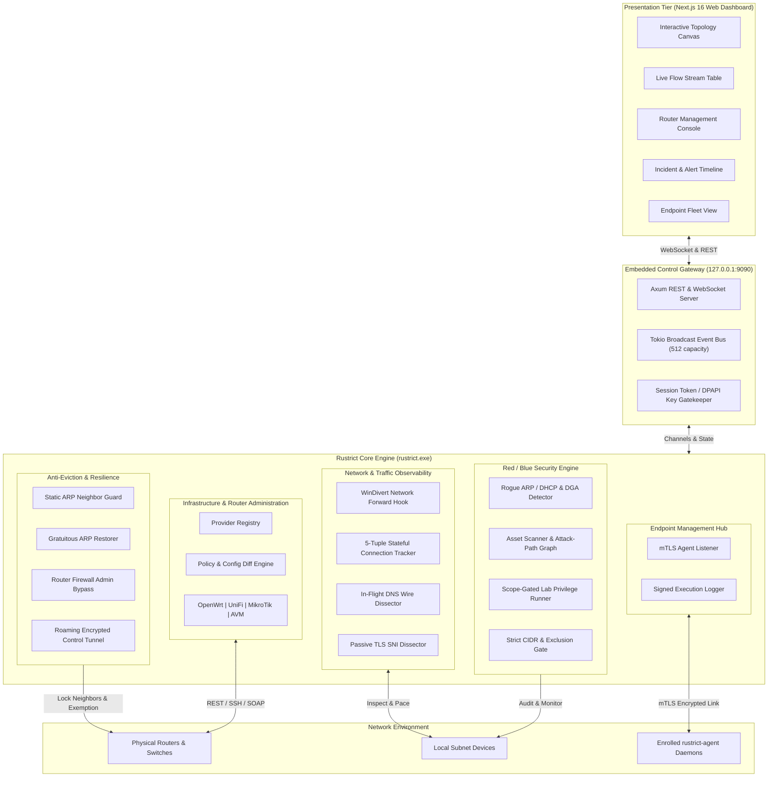

# Rustrict Platform Expansion & Architecture Design Specification
## Comprehensive Network Security, Infrastructure Control & Red/Blue Operations Platform

**Document Identifier:** `RUSTRICT-SPEC-2026-11-24`  
**Status:** Approved Architectural Specification  
**Author:** Antigravity / Rustrict Architecture Team  
**Target Date:** 2026-11-24  
**Companion Plan:** [docs/superpowers/plans/2026-11-24-rustrict-platform-expansion.md](file:///d:/Vault/Rustrict/docs/superpowers/plans/2026-11-24-rustrict-platform-expansion.md)  

---

## 1. Intent & The Why

### 1.1 Problem Statement
Rustrict began as an advanced Layer-2 ARP inspection and Layer-3 WinDivert traffic shaper for Windows. While highly effective at local host discovery, microsecond packet pacing, and network rate limiting, standalone CLI tools have intrinsic operational limitations:
1. **Local Host Eviction Vulnerability:** When operating in hostile or contested LAN environments, competing ARP spoofers or router Dynamic ARP Inspection (DAI) mechanisms can sever or disrupt the operator's machine connectivity.
2. **Disconnected Ecosystem:** Network management (router configuration, DHCP reservations, firewall rules), security auditing (TLS/SMB posture), network observability (traffic flows), and defensive monitoring (rogue ARP detection) traditionally require 4-5 disparate software suites.
3. **Decoupled User Experience:** The companion web dashboard (`rustrict-web`) exists as a modern Next.js 16 showcase but has no live bidirectional data link to the Rust engine running in the terminal.

### 1.2 The Vision
To evolve Rustrict into a coherent, production-grade **Network Security, Infrastructure Control, and Unified Operations Platform**. It merges:
- **Resilience:** Multi-layered anti-eviction and connection preservation.
- **Infrastructure Governance:** Direct, authenticated router administration across OpenWrt, MikroTik, UniFi, and AVM FRITZ!Box.
- **Observability:** Zero-copy Layer 3-4 flow tracking, in-flight DNS query logging, and passive TLS SNI inspection.
- **Defensive Operations (Blue Team):** Real-time intrusion detection for rogue ARP, rogue DHCP, and DNS tunneling/DGA.
- **Authorized Assessment (Red Team):** Scope-gated attack-surface mapping and controlled lab privilege evaluation.
- **Remote Fleet Administration:** Enrolled, cryptographically authenticated, and transparent endpoint management via `rustrict-agent`.
- **Unified Web Operations Console:** A live Next.js 16 + React 19 dashboard communicating over an authenticated WebSocket/REST event bus.

---

## 2. Goals, Non-Goals & Anti-Goals

### 2.1 Goals
- **G1 (Unified Control Plane):** Consolidate network scanning, bandwidth shaping, router management, traffic observability, and defensive alerts into one asynchronous Rust engine (`rustrict.exe`).
- **G2 (Real-Time Web Bridge):** Embed an authenticated, local Axum REST and WebSocket server (`127.0.0.1:9090`) to stream telemetry and receive operator commands from `rustrict-web`.
- **G3 (Anti-Eviction Guarantee):** Ensure the operator machine cannot be knocked off the network or isolated by rogue ARP pulses, competing spoofers, or DHCP blips.
- **G4 (Zero-Copy Traffic Observability):** Dissect forwarded packets in WinDivert to generate 5-tuple flow metrics, DNS query logs, and TLS SNI summaries without decrypting or storing private payloads.
- **G5 (Defensive Detection):** Alert in real-time when unauthorized network changes occur (rogue DHCP offers, gateway MAC discrepancies, anomalous DNS entropy).
- **G6 (Safe Lab Research):** Enable reproducible privilege-boundary evaluations against explicitly designated, lab-isolated targets.
- **G7 (Transparent Endpoint Management):** Manage enrolled Windows/Linux endpoints with verifiable identity, role-based controls, and complete operational visibility.

### 2.2 Non-Goals
- **NG1 (Payload Interception / Deep Packet Decryption):** Rustrict will not act as a rogue MITM CA proxy that decrypts HTTPS traffic, steals credentials, or intercepts end-to-end encrypted user communications. Observability is restricted to L3/L4 metadata, DNS names, and TLS SNI hostnames.
- **NG2 (Unrestricted WAN Exploitation):** Rustrict is not an indiscriminate mass-scanning tool for public Internet ranges. Its operational scope is strictly bound to authorized local subnets and explicitly enrolled lab environments.
- **NG3 (Standalone Cloud SaaS Dependency):** Rustrict will not depend on third-party cloud servers or external telemetry pipelines. All state, logs, and cryptographic credentials reside locally on the host machine.

### 2.3 Anti-Goals (What We Will NEVER Build)
- **AG1 (Covert Persistence or Stealth Agents):** `rustrict-agent` must **never** hide its processes, disguise itself as a system rootkit, or evade user detection. It must be explicitly enrolled, visibly run as a registered service, and be trivially uninstalled by the endpoint administrator.
- **AG2 (Bypassing Scope Safeguards):** The engine will **never** allow administrative mutations or penetration simulations to target IP addresses outside authorized CIDRs or addresses present on the exclusion list (e.g., domain controllers, gateways).

---

## 3. System Constraints & Operating Boundaries

1. **Operating System & Architecture:**
   - Primary Platform: Windows 10/11 x86_64 (`x86_64-pc-windows-msvc`).
   - Endpoint Agent: Cross-platform (Windows & Linux).
   - Compiler Requirement: Stable Rust 1.88+ (2021 Edition).
2. **Kernel Driver Boundaries:**
   - Packet Filtering & Injection: WinDivert 2.2 (`WinDivert.dll` / `WinDivert64.sys`) on forward layer (`NETWORK_FORWARD`).
   - L2 Raw Injection: Npcap (`wpcap.dll` / `Packet.dll`) for directed ARP frames.
   - Platform APIs: Native Win32 `IpHlpApi` (`GetIpNetTable`, `SendARP`) and `WinSock`.
3. **Wireless Constraints:**
   - Because Windows NDIS 6.x drivers block raw 802.11 management frame transmission (such as Deauth frames), wireless management injection requires an external Linux sidecar / USB/IP dongle. Windows-native wireless features remain strictly passive capture (via Npcap `rfmon`).
4. **Zero-Regression Mandate:**
   - All 358 existing tests across 31 test suites must continue to pass with zero failures.

---

## 4. Architectural Approaches Evaluated

| Approach | Architecture | Advantages | Disadvantages | Decision |
|---|---|---|---|---|
| **Option A: Microservices Cluster** | Separate daemons for routing, packet sniffing, web server, and IDS communicating via gRPC. | Decoupled components; independent restarts. | High memory overhead; complex multi-process coordination on Windows; difficult service packaging. | **Rejected** |
| **Option B: Pure CLI with Polled File State** | Core writes JSON files; Next.js polls files via Node.js API routes. | Simple; no sockets needed. | High disk I/O; poor real-time latency (>1s lag); race conditions under high packet flow; no live streaming. | **Rejected** |
| **Option C: Unified Asynchronous Core with Embedded Gateway (Chosen)** | Single Rust binary embedding a Tokio multithreaded runtime, Axum REST/WebSocket server on `127.0.0.1:9090`, and an in-memory broadcast bus. | Microsecond latency; zero IPC overhead; single executable deployment; shared state protected by `parking_lot::RwLock`. | Requires clean modular boundaries to keep codebase maintainable. | **Selected** |

---

## 5. Detailed Architecture Across All 8 Phases



---

### Phase 1: Core Async Engine, Event Bus & WebSocket Bridge
- **Module:** `src/server/`
- **Key Structs & Traits:**
  - `EngineEvent`: Enum representing events (`HostDiscovered`, `HostUpdated`, `FlowSampled`, `SecurityAlert`, `RouterStateChanged`, `PolicyExecuted`).
  - `EventBus`: Wrapped `tokio::sync::broadcast::Sender<EngineEvent>` with backpressure handling and ring-buffer eviction.
  - `ServerState`: Shared thread-safe context (`Arc<RwLock<AppState>>`) holding the host list, router provider, flow table, and scope manager.
- **REST Endpoints:**
  - `GET /api/status`: System, interface, adapter, and limiter telemetry.
  - `GET /api/hosts`: Discovered network host inventory.
  - `POST /api/hosts/:id/enforce`: Trigger block/free/limit action.
  - `GET /api/router/status`: Current connected router status and capabilities.
  - `POST /api/router/pause`: Enforce router hardware pause.
  - `GET /api/traffic/flows`: Active 5-tuple connection streams.
  - `GET /api/defense/alerts`: Live blue-team security alert feed.
- **WebSocket Endpoint:**
  - `GET /api/ws`: Upgrades client to bi-directional JSON streaming channel for real-time telemetry updates.

---

### Phase 2: Anti-Eviction & Connection Resilience Subsystem
- **Module:** `src/resilience/`
- **Key Components:**
  1. **Layer 2 Static ARP Guard (`src/resilience/arp_guard.rs`):**
     - Queries Windows IP Helper API (`CreateIpNetEntry2` / `netsh interface ipv4 add neighbors`).
     - Pins the default gateway IP to its verified physical MAC as a permanent `STATIC` entry in the Windows kernel routing table.
     - Intercepts incoming ARP traffic via WinDivert: drops any unsolicited ARP reply that attempts to associate the gateway IP with a foreign MAC.
  2. **Active Healer:**
     - Periodic 2-second background heartbeat verifying that the gateway MAC in the kernel matches the genuine router MAC.
     - If tampering is detected, transmits a burst of 3 directed Gratuitous ARP (GARP) frames to restore the genuine gateway association within 50ms.
  3. **Router Admin Exemption (`src/resilience/router_exemption.rs`):**
     - On router connection, automatically inserts a priority Rule #1 in the router's firewall/traffic rule engine:
       - OpenWrt: `nft insert rule inet fw4 forward ether saddr <Operator_MAC> accept`
       - MikroTik: `/ip firewall filter add chain=forward src-mac-address=<Operator_MAC> action=accept place-before=0`
       - UniFi: Traffic rule bypassing all content filters and pause rules for the operator MAC.
     - Ensures the operator is immune to accidental self-blocking or router-wide lockdowns.
  4. **Roaming Overlay Control Tunnel (`src/resilience/tunnel.rs`):**
     - Encrypted UDP-based control tunnel maintaining continuous session state across physical Wi-Fi roaming, adapter disconnects, and IP address changes.

---

### Phase 3: Advanced Router & Network Infrastructure Management
- **Module:** `src/gateway/admin/`
- **Extended Capabilities:**
  1. **DHCP & DNS Management (`dhcp_dns.rs`):**
     - Query and parse active DHCP lease databases across all 4 router types.
     - Create, update, and delete static DHCP reservations (MAC $\rightarrow$ IP $\rightarrow$ Hostname).
     - Inspect and reconfigure upstream DNS servers (e.g., pointing router DNS to Cloudflare, Quad9, or local Pi-hole).
  2. **NAT & Port Forwarding (`nat_routes.rs`):**
     - Read and audit existing WAN-to-LAN port forward rules.
     - Detect dynamic UPnP pinholes and alert on exposed internal services (e.g., exposed RDP port 3389 or SMB 445).
     - Extract and validate routing tables (checking for default route hijacking or anomalous static routes).
  3. **Configuration Snapshot & Diff Engine (`config_backup.rs`):**
     - Generates atomic, encrypted JSON backups of router configurations.
     - Computes unified side-by-side diffs between current configuration and historical baselines.
     - Supports one-click rollback if a configuration change degrades connectivity.

---

### Phase 4: Network Traffic Observability & Kernel Packet Dissection
- **Module:** `src/monitor/`
- **Key Components:**
  1. **5-Tuple Stateful Connection Tracker (`flow_tracker.rs`):**
     - Hooks directly into `run_windivert_loop` in `src/limiter/divert.rs`.
     - Key: `FlowKey { src_ip: Ipv4Addr, dst_ip: Ipv4Addr, src_port: u16, dst_port: u16, protocol: u8 }`.
     - Value: `FlowMetrics { start_time: Instant, last_seen: Instant, bytes_sent: u64, bytes_recv: u64, packets: u64, tcp_state: TcpState }`.
     - Automatically retires idle flows after 30 seconds of inactivity or upon receiving TCP FIN/RST.
  2. **In-Flight DNS Wire Dissector (`dns_dissector.rs`):**
     - Sniffs UDP/TCP port 53 packets in-flight.
     - Extracts query domain name, transaction ID, record type (A, AAAA, PTR, TXT), and response IP addresses.
     - Maintains a per-device DNS resolution history (`Host IP` $\rightarrow$ `Domain` $\rightarrow$ `Resolved IP`).
  3. **Passive TLS SNI Dissector (`tls_sni.rs`):**
     - Inspects the first data packet of outbound TCP port 443 connections.
     - Detects TLS Record Type `0x16` (Handshake) and Handshake Type `0x01` (ClientHello).
     - Extracts the Server Name Indication (SNI) string without decrypting application data.
     - Identifies target cloud services and domains (e.g., `api.github.com`, `discord.com`).

---

### Phase 5: Blue-Team Monitoring & Intrusion Detection
- **Module:** `src/defense/`
- **Detection Capabilities:**
  1. **Rogue ARP Poisoning Detector (`arp_detector.rs`):**
     - Detects ARP spoofing attacks occurring anywhere on the subnet.
     - Flags whenever an ARP reply claims the gateway IP with a MAC different from the baseline gateway MAC.
  2. **Rogue DHCP Server Detector (`dhcp_detector.rs`):**
     - Sniffs DHCP Offer / ACK messages on UDP port 68.
     - Flags whenever a DHCP Offer originates from an unauthorized IP/MAC address.
  3. **DNS Entropy & Tunneling Heuristics (`dns_heuristics.rs`):**
     - Calculates Shannon entropy for queried domain sublabels:
       $$H(X) = -\sum_{i=1}^{n} P(x_i) \log_2 P(x_i)$$
     - Alerts on sublabels with length $>30$ characters and $H > 3.8$ (strong indicators of DNS data exfiltration or malware DGA).
  4. **Port Scan / Sweep Detector (`scan_detector.rs`):**
     - Tracks SYN connection attempts per source IP across 5-second sliding windows.
     - Triggers an alert when a single IP attempts connections to $>20$ closed ports.

---

### Phase 6: Red-Team Testing & Controlled Privilege Research
- **Module:** `src/probes/` & `src/core/`
- **Assessment Capabilities:**
  1. **Attack-Path Topology Graph (`attack_graph.rs`):**
     - Models discovered hosts, open ports, and discovered router interfaces as a directed graph.
     - Highlights high-risk pivot routes (e.g., IoT camera on subnet $\rightarrow$ router web interface with default credentials $\rightarrow$ enterprise VLAN).
  2. **Router Baseline & Privilege Audit:**
     - Checks for exposed Telnet (port 23), unencrypted HTTP management (port 80), default community strings (`public`/`private`), and insecure SSH ciphers.
  3. **Scope-Gated Lab Privilege-Escalation Harness (`lab_simulation.rs`):**
     - **Hard Isolation Gate:** Simulations will only execute against targets residing in subnets explicitly flagged with `is_lab_isolated: true` in the Scope Manager.
     - Tests for specific configuration flaws in authorized test appliances (e.g., writable OpenWrt `/etc/init.d/` scripts, sudoers wildcard rules, command injection in vulnerable test firmware).
     - Verifies whether the attempted privilege transition triggered defense alerts in the Blue-Team engine.

---

### Phase 7: Enrolled Remote Administration Agent (`rustrict-agent`)
- **Location:** `crates/rustrict-agent/` (Independent binary crate within Cargo workspace).
- **Architecture:**
  - Lightweight compiled binary (~4 MB, zero runtime dependencies).
  - Cross-platform: Runs as a Windows Service (`RustrictAgent`) or Linux `systemd` unit.
- **Security & Enrollment Protocol:**
  - On first boot, generates an Ed25519 keypair.
  - Enrollment requires an administrator-generated one-time pairing token.
  - Communications use mutually authenticated TLS (mTLS) with certificate pinning.
- **Functionality:**
  - **Telemetry:** Streams CPU, RAM, disk utilization, active network interfaces, and listening ports every 5 seconds.
  - **Service Management:** List, start, stop, and query system services.
  - **Process Inventory:** Live process table with PID, parent PID, CPU share, and user context.
  - **Audited Remote Commands:** Executes signed commands with strict timeout bounds; streams stdout/stderr back to the controller with cryptographic hash logging.
  - **Immediate Unenrollment:** Running `rustrict-agent unenroll` wipes keys, clears local state, uninstalls the service, and terminates cleanly.

---

### Phase 8: Unified Web Operations Dashboard Integration (`rustrict-web`)
- **Location:** `d:\Vault\rustrict-web` (Next.js 16 + React 19 + Tailwind v4).
- **Components:**
  1. **Interactive Topology Canvas (`src/components/TopologyCanvas.tsx`):**
     - Force-directed visual graph rendering routers, switches, discovered devices, and enrolled agents.
     - Color-coded connection links indicating live bandwidth volume and latency.
  2. **Live Flow Stream Table (`src/components/FlowStreamTable.tsx`):**
     - Real-time virtualized table streaming 5-tuple connections, active protocols, and transferred bytes.
  3. **Router Administration Console (`src/components/RouterAdminPanel.tsx`):**
     - Visual DHCP reservation manager, port-forwarding matrix, and router configuration diff viewer.
  4. **Security Operations & Incident Timeline (`src/components/IncidentTimeline.tsx`):**
     - Real-time event stream showing Blue-Team detection alerts and Red-Team audit findings with SARIF severity badges.

---

## 6. Security, Authorization & Audit Integrity Model

```
┌─────────────────────────────────────────────────────────────────────────────────────────────────┐
│                                SECURITY & AUTHORIZATION MODEL                                   │
├─────────────────────────┬───────────────────────────────────────────────────────────────────────┤
│ Control Principle       │ Implementation Mechanism                                              │
├─────────────────────────┼───────────────────────────────────────────────────────────────────────┤
│ Fail-Closed Scope Gate  │ `ScopeManager` validates target CIDR, IP exclusions, and MAC bounds   │
│                         │ before allowing any packet injection, scan, or policy execution.      │
├─────────────────────────┼───────────────────────────────────────────────────────────────────────┤
│ Cryptographic Secrets   │ Windows DPAPI (`CryptProtectData`) encrypts router passwords and      │
│                         │ private keys on disk; memory buffers zeroed on drop via `zeroize`.     │
├─────────────────────────┼───────────────────────────────────────────────────────────────────────┤
│ Immutable Audit Trails  │ Every policy mutation, scan, and command execution is hashed and      │
│                         │ recorded in persistent append-only logs (`rustrict_audit.json`).      │
├─────────────────────────┼───────────────────────────────────────────────────────────────────────┤
│ Safe Emergency Shutdown │ Signal handlers (`Ctrl+C` / SIGINT) automatically restore kernel ARP  │
│                         │ tables, unload WinDivert, and restore genuine gateway routes.         │
├─────────────────────────┼───────────────────────────────────────────────────────────────────────┤
│ Role-Based UI Access    │ Local API tokens gate administrative mutations (pause/resume/config)  │
│                         │ while allowing unauthenticated read-only dashboard preview on LAN.    │
└─────────────────────────┴───────────────────────────────────────────────────────────────────────┘
```

---

## 7. What's Left to the Builder & Implementation Checklist

A builder implementing this specification will execute against the companion step-by-step TDD plan in [`docs/superpowers/plans/2026-11-24-rustrict-platform-expansion.md`](file:///d:/Vault/Rustrict/docs/superpowers/plans/2026-11-24-rustrict-platform-expansion.md):

- [ ] **Phase 1:** Build `src/server/event_bus.rs`, `src/server/routes.rs`, and WebSocket streaming server.
- [ ] **Phase 2:** Implement `src/resilience/arp_guard.rs` and router administrative exemptions.
- [ ] **Phase 3:** Extend router providers with DHCP lease management and configuration diffing.
- [ ] **Phase 4:** Build `src/monitor/flow_tracker.rs` and in-flight DNS/SNI dissectors.
- [ ] **Phase 5:** Build `src/defense/` with rogue ARP, rogue DHCP, and DNS entropy detectors.
- [ ] **Phase 6:** Build attack-path graphing and scope-gated lab simulation runner.
- [ ] **Phase 7:** Scaffold `crates/rustrict-agent/` with mTLS telemetry and service manager.
- [ ] **Phase 8:** Connect `rustrict-web` to `ws://127.0.0.1:9090/api/ws` and render the live operations console.
